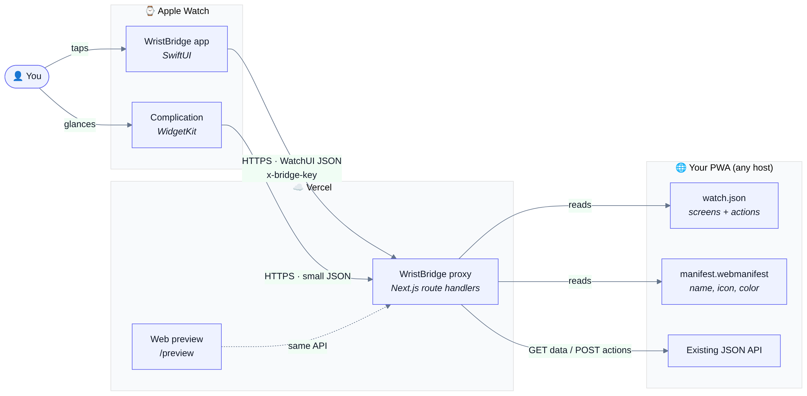

# 00 · Start here (plain-English overview)

## The problem

You built a PWA (a website that installs like an app). On an iPhone it works great.
On an Apple Watch **it can't run at all**: watchOS has no Safari you can open, no "Add to Home Screen", and no supported way to show a web page inside a third-party app.

## The idea

Don't send the web page to the watch. Send a **description of the screen** in plain JSON instead, and let a small native watch app draw it.

> **Analogy: a restaurant**
> - Your **PWA** is the kitchen. It already has the food (your data, via its JSON API).
> - The **proxy** is the waiter. It takes the watch's order, fetches from the kitchen, and plates it in a standard way.
> - The **watch app** is the table. It doesn't cook; it just knows how to display any plate that follows the menu's rules.
> - **watch.json** is the menu. Your PWA writes it once to say what dishes (screens) exist and how they're plated.
> - **WatchUI** is the plating standard. Every plate is built from the same 11 kinds of pieces (text, row, metric, gauge, chart, and so on).

Because every plate follows the same standard, **one watch app can show any PWA**. You never rebuild the watch app for a new website; you just write a new `watch.json`.

## The three parts

| Part | Folder | Language | What it does |
|---|---|---|---|
| **Proxy** | `proxy/` | TypeScript, Next.js, Vercel | Reads `watch.json`, fetches your data, renders it into WatchUI JSON, keeps it small, caches it, and runs actions such as "mark done". |
| **Watch app** | `watch/` | Swift, SwiftUI | Lists your apps, asks the proxy for screens, and draws them natively. Includes haptics, an offline cache and a watch-face complication. |
| **Schema** | `schema/` | JSON Schema | The formal contract both sides agree on, plus real example payloads. |

A **demo PWA** ("Demo Tasks") lives inside the proxy at `/demo`, so everything works end to end before you connect your own app.

## Reading order

1. **This page**
2. [01 · Architecture](01-architecture.md): the system design, the diagrams, and why each decision was made
3. [02 · Setup](02-setup.md): run it on your laptop, then on Vercel, then on your watch
4. [03 · WatchUI schema](03-watchui-schema.md): the 11 building blocks
5. [04 · watch.json and templates](04-descriptor.md): how to connect **your** PWA
6. [05 · HTTP API](05-api.md), [06 · Security](06-security.md), [07 · Watch app internals](07-watch-app.md)
7. [08 · Roadmap and interview notes](08-roadmap.md), [09 · Extending](09-extending.md), [10 · Glossary](10-glossary.md)

If a word is unfamiliar (ETag, SSRF, complication, ...), check the [glossary](10-glossary.md).

## Project status (honest)

| Area | Status |
|---|---|
| Proxy | Built, type-checked, 23 unit tests passing, production build OK, smoke test against a running server passing |
| Web preview | Built and checked in a headless browser |
| Watch app (Swift) | Fully written and syntax-checked, but **not compiled yet**: it was written on Linux, where Xcode isn't available. Expect a few small compile fixes the first time you open it in Xcode. See `CLAUDE.md` → "First session checklist". |
