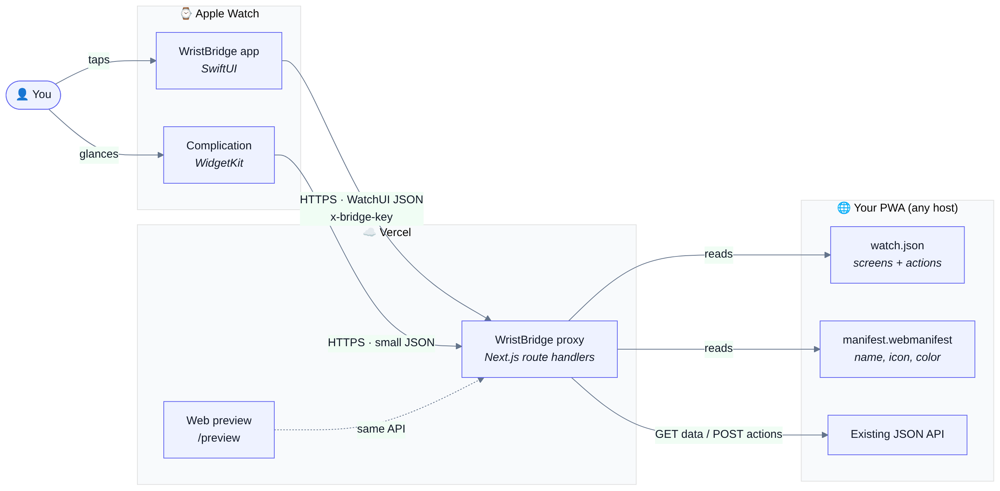
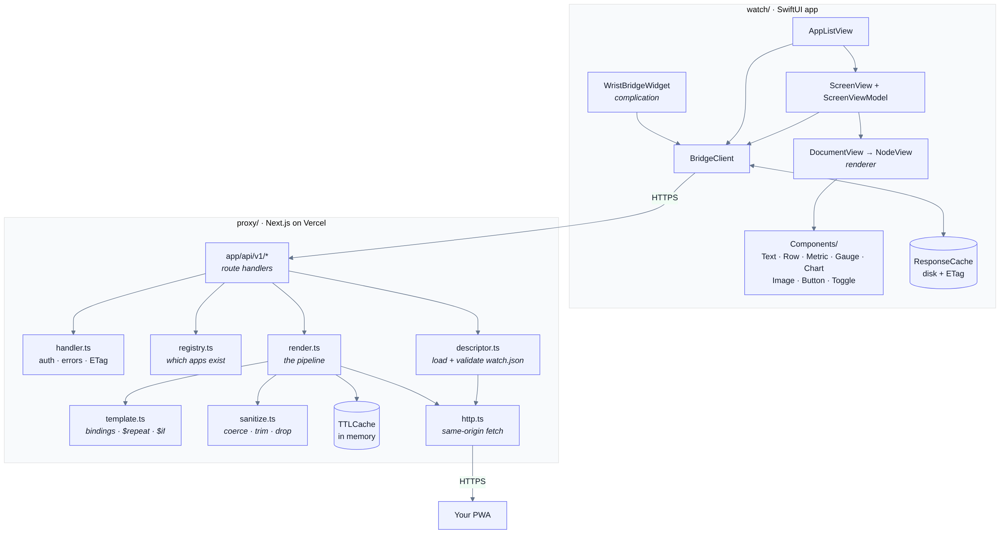
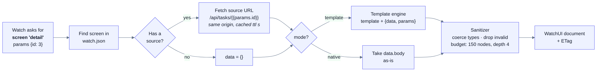
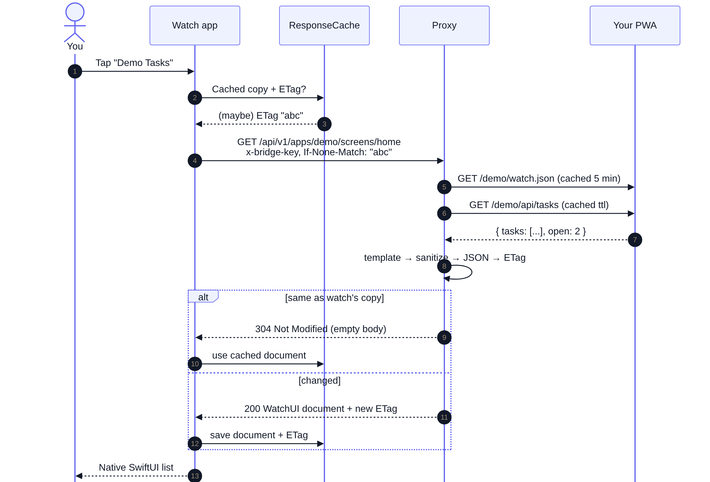
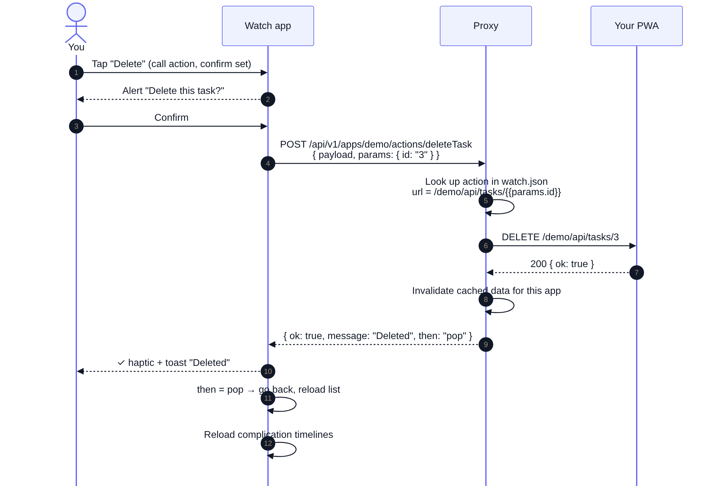
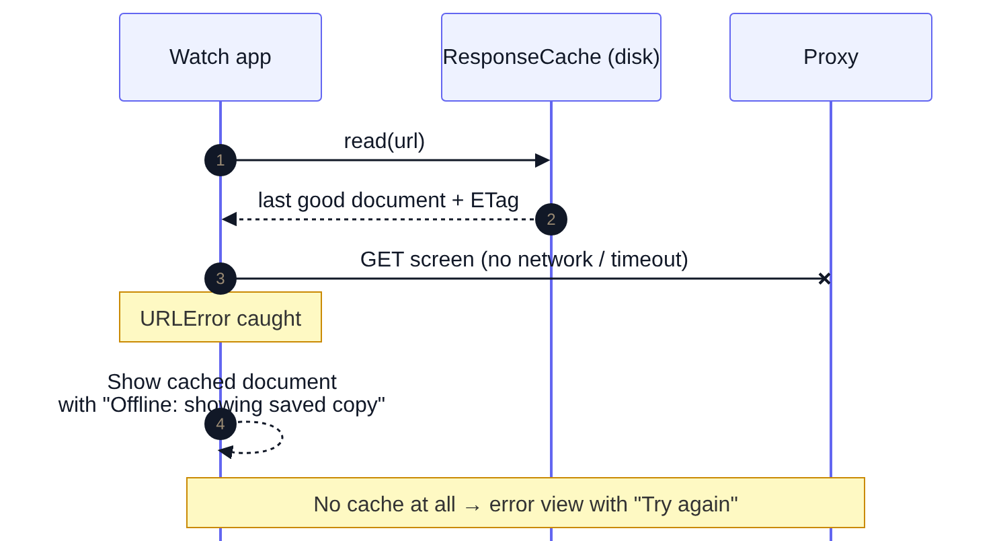
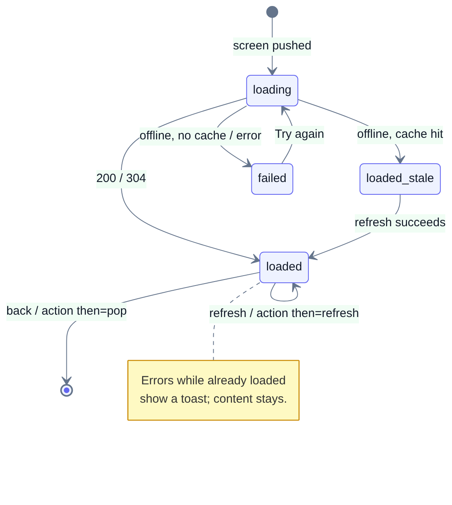
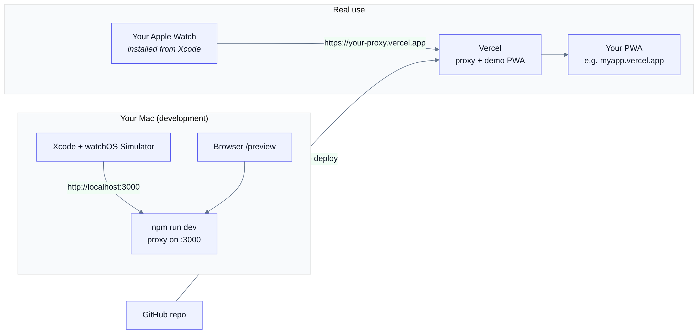

# 01 · Architecture (system design)

## 1. Goals and non-goals

**Goals**
- Any PWA can appear on Apple Watch by publishing one file (`watch.json`), with **no watch-side code per app**.
- The UI should feel native (SwiftUI lists, haptics, complications), not like a shrunken web page.
- Payloads stay tiny and fast: the watch is slow, has a small battery, and its network is often unreliable.
- Running it costs nothing: Vercel's free tier, plus a free Apple ID for your own watch.

**Non-goals (for v1)**
- Running arbitrary JavaScript or rendering HTML on the watch. The [engine discussion](08-roadmap.md#why-not-a-browser-engine) explains why.
- Multi-user accounts on the proxy. v1 has a single shared key for your own devices.
- Push notifications (planned; see the roadmap).

## 2. System context

| Actor | Talks to | Over | Carries |
|---|---|---|---|
| Watch app | Proxy | HTTPS, `x-bridge-key` header | WatchUI documents, action results |
| Complication | Proxy | HTTPS | A ~150-byte summary |
| Proxy | Your PWA | HTTPS, **same origin only** | `watch.json`, the manifest, your JSON API |
| Web preview | Proxy | Same API | Lets you design screens in a browser |

## 3. Components

### Proxy (`proxy/`)

| File | Responsibility | Plain words |
|---|---|---|
| `app/api/v1/**/route.ts` | HTTP endpoints | The doors the watch knocks on |
| `lib/handler.ts` | Auth, error → JSON, ETag/304 | The bouncer and the receipt printer |
| `lib/registry.ts` + `watchbridge.config.ts` | Which apps exist and where they live | The address book |
| `lib/descriptor.ts` | Load and validate `watch.json` and the manifest (cached 5 min) | Reads the menu |
| `lib/render.ts` | **The pipeline** (below) | The waiter's routine |
| `lib/template.ts` | `{{bindings}}`, filters, `$repeat`, `$if` | Fills in the blanks |
| `lib/sanitize.ts` | Coerce types, drop invalid nodes, enforce size budgets | Quality control before the plate leaves |
| `lib/http.ts` | The only outbound fetch: same-origin, 8 s timeout, 1 MB cap | The waiter only goes to *your* kitchen |
| `lib/cache.ts` | In-memory TTL cache | A short-term memory |
| `app/demo/**`, `lib/demo-store.ts` | Demo PWA | A sample kitchen |
| `app/preview`, `components/WatchPreview.tsx` | Browser renderer | A practice table |

### Watch app (`watch/`)

| File | Responsibility |
|---|---|
| `WristBridge/App/WristBridgeApp.swift`, `Navigator.swift` | App entry point and the navigation stack |
| `WristBridge/Views/AppListView.swift` | First screen: the registered apps |
| `WristBridge/Views/ScreenView*.swift` | Loads one screen and handles its actions (confirm → call → haptic → refresh/pop) |
| `WristBridge/Rendering/*` | JSON node → SwiftUI view |
| `Shared/Model/WatchUI.swift` | Codable mirror of the schema. Tolerant: unknown nodes become a placeholder |
| `Shared/Networking/BridgeClient.swift` | All networking, ETag revalidation, offline fallback |
| `Shared/Networking/ResponseCache.swift` | Disk cache of the last good responses |
| `WristBridgeWidget/` | Complications (circular, rectangular, inline, corner) |

## 4. The render pipeline

1. **Look up** the screen in `watch.json`.
2. **Fetch** its `source` URL. Bindings such as `{{params.id}}` are filled and URL-encoded. The URL must be on the app's own origin, and GET responses are cached for the screen's `ttl`.
3. **Render.** In `template` mode, the template is filled with `{ data, params, app }`. In `native` mode, the PWA has already returned `{ body: [...] }`.
4. **Sanitize.** Types are coerced (`"0.4"` → `0.4`), invalid nodes are dropped (with warnings, never a crash), and budgets are enforced: 150 nodes, depth 4, 60 children, 400 characters of text, 40 chart points.
5. **Respond** with JSON, an `ETag`, and `Cache-Control: private, max-age=ttl`.

## 5. Key flows

### Opening a screen (with ETag)

### Running an action

### Offline

### Screen state machine (watch)

## 6. Deployment

- **Proxy:** one Vercel project with root directory `proxy/`. It runs as serverless Node functions, with no database.
- **Watch app:** installed from Xcode. A free Apple ID works for your own watch; the app expires every 7 days and you reinstall it. The App Store needs the paid developer program ($99/yr).

## 7. Design decisions (and trade-offs)

These are the "why" answers to have ready for interviews.

| # | Decision | Why | Trade-off accepted |
|---|---|---|---|
| D1 | **Server-driven UI** (JSON describes screens; the watch only renders) | One watch binary serves every PWA. Screens change without reinstalling the app, which matters a lot given free-account installs expire every 7 days. | Layouts are limited to what the schema can express. |
| D2 | **A proxy in the middle** rather than the watch calling PWAs directly | It shrinks payloads (watch CPU and battery), caches, hides app tokens from the watch, enforces one schema, and lets one key protect everything. | One more hop, plus a service to deploy. |
| D3 | **Declarative templates** (`watch.json`) instead of PWA code changes | Most PWAs already have a JSON API, so connecting one is a single static file. | A tiny template language to learn. `native` mode is the escape hatch. |
| D4 | **Sanitize, don't validate-and-reject** | One bad node shouldn't blank a whole screen on your wrist. | Bugs can hide, which is why warnings show up in `?debug=1` and the preview. |
| D5 | **Tolerant decoding** on the watch (unknown → placeholder) | An old watch build keeps working when the proxy adds components (forward compatibility). | The user may see "Update the app to see …". |
| D6 | **ETag + disk cache** on the watch | 304 responses cost almost nothing, and the last good screen still shows offline. | Offline data can be stale, so it's clearly labelled. |
| D7 | **Same-origin fetch only** | Stops the proxy being abused to reach internal or other hosts (SSRF). | A PWA whose API lives on another origin must register that origin as its own app entry or use `native` mode. |
| D8 | **In-memory cache, no database** | Free and simple; correctness doesn't depend on it. | No cache sharing across serverless instances (Vercel KV is on the roadmap). |
| D9 | **Complications fetch directly** (no App Group) | App Groups need a paid account, and this works with a free Apple ID. | The widget makes its own network call. |
| D10 | **XcodeGen** (`project.yml`) instead of a committed `.xcodeproj` | Readable, reviewable, no merge conflicts, and easy for Claude Code to edit. | You run `xcodegen generate` after cloning. |

## 8. Quality attributes

| Attribute | How it's handled |
|---|---|
| Performance | Typical document is 1–4 KB; repeat views return 304; upstream calls are cached per `ttl` |
| Reliability | Per-node sanitization, offline fallback, unreachable apps skipped in the app list |
| Security | Key auth (timing-safe compare), same-origin fetch, manual redirects, timeouts and size caps, tokens stay on the server ([06](06-security.md)) |
| Evolvability | Versioned schema (`schemaVersion: "1"`), tolerant decoders, a [checklist](09-extending.md) for adding components |
| Testability | Pure functions (template, sanitize) plus an in-process pipeline test validated against the JSON Schema |
